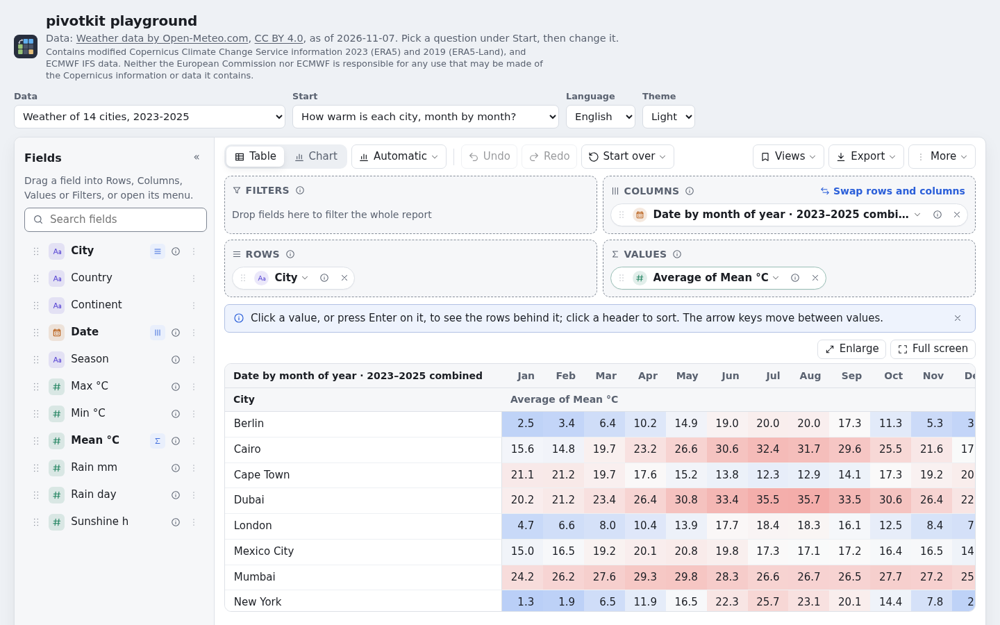

<p align="center">
  <picture>
    <source media="(prefers-color-scheme: dark)" srcset="assets/header-dark.svg">
    
  </picture>
</p>

pivotkit is Excel's PivotTable for web applications and the command line. People load their data,
build a report by dragging fields and take it to Excel. The same report renders again in CI.

| Who you are | What you want | Quickest start |
| --- | --- | --- |
| A user | a report from your data, by clicking | Try the [live demo](https://pivotkit.eize.dev/demo/), then build a first report in six steps with the [quick start](https://pivotkit.eize.dev/use/quick-start/). |
| An operator | the REST service and the MCP server in your environment | Start the container with one `docker run`: [server in 5 minutes](https://pivotkit.eize.dev/getting-started/server-in-5-minutes/). |
| A user of a running server | a report with curl, PowerShell or an AI client | [REST service](https://pivotkit.eize.dev/getting-started/rest/) for curl and PowerShell, [MCP server](https://pivotkit.eize.dev/getting-started/mcp/) for an AI client. |
| A developer | the report in your application, or reports from your code | Pick the package that fits and build a first report with it: [Embed pivotkit](https://pivotkit.eize.dev/embed/). |



<sub>Weather data by [Open-Meteo.com](https://open-meteo.com/) ([CC BY 4.0](https://creativecommons.org/licenses/by/4.0/)); contains modified Copernicus Climate Change Service information 2023 (ERA5) and 2019 (ERA5-Land), and ECMWF IFS data ([sources](examples/playground/data/SOURCES.md)).</sub>

[Live demo](https://pivotkit.eize.dev/demo/) · [Documentation](https://pivotkit.eize.dev/) · [Features](https://pivotkit.eize.dev/features/) · [Comparison](https://pivotkit.eize.dev/compare/) · [Security](docs/security.md) · [Security policy](SECURITY.md) · [Releases and changelogs](#releases-and-changelogs)

| | |
| --- | --- |
| Build | [](https://github.com/eizedev/pivotkit/actions/workflows/ci.yml) [](https://github.com/eizedev/pivotkit/actions/workflows/docs.yml) |
| Documentation | [pivotkit.eize.dev](https://pivotkit.eize.dev/). [Use a report](https://pivotkit.eize.dev/use/) is for the people who build reports. [Embed pivotkit](https://pivotkit.eize.dev/embed/) and the API reference are for developers. To try it, open the [live demo](https://pivotkit.eize.dev/demo/). [Learn with real data](https://pivotkit.eize.dev/learn/) walks through weather, countries, earthquakes, Nobel laureates and software end of life. |
| npm | [](https://www.npmjs.com/package/pivotkit-core) [](https://www.npmjs.com/package/pivotkit-react) [](https://www.npmjs.com/package/pivotkit-element) [](https://www.npmjs.com/package/pivotkit-xlsx) [](https://www.npmjs.com/package/pivotkit-report) [](https://www.npmjs.com/package/pivotkit-cli) [](https://www.npmjs.com/package/pivotkit-server) [](https://www.npmjs.com/package/pivotkit-mcp) |
| License | [](LICENSE) |

## What pivotkit does

- Where the application allows it, people drop their own CSV, JSON or Excel file onto the report.
  A preview shows a type for each column. Nothing is uploaded.
  More: [load your own data](https://pivotkit.eize.dev/use/load-data/).
- The [export](https://pivotkit.eize.dev/use/export/) to Excel keeps the layout. The rows behind
  the report download as CSV or JSON.
- A view is safe JSON: it cannot run code. Reports also come without a browser.
  `pivotkit render` makes the same report from the downloaded view and data.
  `pivotkit describe sales.xlsx --suggest` makes a first view from a file's fields.
  More: [command line](https://pivotkit.eize.dev/getting-started/cli/).
- Other programs get reports from a [REST service](https://pivotkit.eize.dev/getting-started/rest/),
  with an OpenAPI document and a container image. AI clients get them from an
  [MCP server](https://pivotkit.eize.dev/getting-started/mcp/), which never hands the model the
  rows. One `docker run` starts both, with a token of their own:
  [server in 5 minutes](https://pivotkit.eize.dev/getting-started/server-in-5-minutes/).
- The REST service and the MCP server read live data. They read a file, call an HTTP API or run
  your own code with the caller's parameters: [sources](https://pivotkit.eize.dev/reference/sources/).
  A model gets rows only where the policy shows them:
  [what reaches an AI model](https://pivotkit.eize.dev/model-data/).
- The services deliver a report in three ways. It comes back in the answer, where the policy
  allows it. It reaches people as a download link that expires. The link is bound to the person's
  sign-in where the data is not open. Or it goes to a store you run, as an upload.
  More: [download links](https://pivotkit.eize.dev/reference/delivery/).

pivotkit is for the people who build reports in an application, and for the developers who put it
there. It is MIT licensed and comes as:

- a React 18/19 component
- a web component, also in PowerShell Universal apps
- a JavaScript engine for the browser and Node
- a command line
- a REST service and an MCP server

The report in the browser computes on the rows the host passes. It fetches no data. The REST service
and the MCP server fetch data from the sources you configure.

The report runs in Chrome and Edge from 111, Firefox from 113 and Safari from 16.4:
[browser support](docs/browser-support.md). The engine, the reports, the CLI, the REST service and
the MCP server run in Node 22 or later.

[Measured performance](docs/concepts/limits.md#measured-in-the-browser) · [Tests and CI](https://github.com/eizedev/pivotkit/actions/workflows/ci.yml)

## Packages

| Package | What | Install |
| --- | --- | --- |
| [pivotkit-core](packages/pivotkit-core/) | The engine in plain JavaScript, with no UI and no framework. | `npm install pivotkit-core` |
| [pivotkit-react](packages/pivotkit-react/) | The React 18/19 report builder: field list, drag and drop, table and chart, filters, saved and shared views, export. The host provides React and ECharts. | `npm install pivotkit-react react react-dom echarts` |
| [pivotkit-element](packages/pivotkit-element/) | The report builder as the web component `<pivot-report>`, with its own React. For Angular, PHP and plain HTML. ECharts loads on the first chart. | `npm install pivotkit-element` |
| [pivotkit-xlsx](packages/pivotkit-xlsx/) | A [plugin](https://pivotkit.eize.dev/reference/plugins/) that reads Excel .xlsx workbooks in the browser. It checks a workbook before it parses it. pivotkit-core reads CSV and JSON itself. | `npm install pivotkit-xlsx` |
| [pivotkit-report](packages/pivotkit-report/) | [Reports without a browser](https://pivotkit.eize.dev/reference/report/), in Node and the browser. It makes a view over rows into JSON, CSV, XLSX, an SVG chart or a printable HTML report from a template. | `npm install pivotkit-report echarts` |
| [pivotkit-cli](packages/pivotkit-cli/) | The [command line](https://pivotkit.eize.dev/reference/cli/) `pivotkit`. It renders, validates and describes views in CI, with exit codes and `--json`. | `npm install --global pivotkit-cli` |
| [pivotkit-server](packages/pivotkit-server/) | A [REST service](https://pivotkit.eize.dev/reference/rest/) over the same operations, with an OpenAPI 3.1 document. Sign-in with tokens or OAuth, and policy profiles. Sources are files or an operator's API: [HTTP sources](https://pivotkit.eize.dev/reference/sources/#http). It is the shared core of the MCP server. One command runs REST, MCP and the CLI, and so does the [container image](https://pivotkit.eize.dev/reference/container/). | `npm install --global pivotkit-server` |
| [pivotkit-mcp](packages/pivotkit-mcp/) | An [MCP server](https://pivotkit.eize.dev/reference/mcp/). An AI client describes data sources, writes and checks views, and has reports made into files or links. The client does not read the data. The server runs over stdio and Streamable HTTP, with a token or OAuth. | `npx -y pivotkit-mcp` |

## Example

The report builder in React. Try it in the [playground](https://pivotkit.eize.dev/playground/):

```jsx
import { PivotReport } from "pivotkit-react";
import "pivotkit-react/styles.css";

<PivotReport data={rows} defaultView={{ rows: ["Region"], values: [{ field: "Sales", agg: "sum" }] }} onViewChange={save} />
```

The same as a web component, on a page without React. Try it on the
[example page](https://pivotkit.eize.dev/playground/examples/element/):

```html
<script type="module" src="/assets/pivotkit-element/dist/index.js"></script>
<pivot-report locale="de-DE" default-view='{"rows":["Region"],"values":[{"field":"Sales","agg":"sum"}]}'></pivot-report>
<script type="module">
    const report = document.querySelector("pivot-report");
    report.data = rows;
    report.addEventListener("pivot-view-change", (e) => save(e.detail.view));
</script>
```

The engine without UI:

```js
import { encode, computePivot, toGrid } from "pivotkit-core";
import { toXlsx } from "pivotkit-core/export";

const data = encode(rows);                       // an array of objects
const result = computePivot(data, {
    rows: ["Region"],
    cols: ["Product"],
    values: [{ field: "Sales", agg: "sum", format: "currency:EUR" }]
});
const grid = toGrid(result);                     // cells with merges, totals and formatted text
const xlsx = toXlsx(grid);                       // Uint8Array
```

The command line, on example files it writes itself:

```bash
npx pivotkit-cli example                 # sales.csv and two views
npx pivotkit-cli render sales.pivotkit.json --data sales.csv -o sales.html
npx pivotkit-cli render sales.csv --rows Region --values sum:Revenue -o by-region.html   # no view file
```

The REST service and the MCP server in a container, with example data. The server makes a token at
its first start. Step by step:
[server in 5 minutes](https://pivotkit.eize.dev/getting-started/server-in-5-minutes/).

```bash
docker run -d --name pivotkit -p 127.0.0.1:3333:3333 -v pivotkit:/var/lib/pivotkit ghcr.io/eizedev/pivotkit:<version>
curl -H "Authorization: Bearer $(docker exec pivotkit pivotkit-server token show admin)" http://127.0.0.1:3333/api/v1/sources
```

The view passed to `computePivot` is plain JSON. The same object is the saved template, the undo
step and what the UI edits. pivotkit treats it as user input: it cannot run code, and the limits in
`LIMITS` keep its memory use bounded.

The [documentation site](https://pivotkit.eize.dev/) has the details for users and developers:

- the [engine's API](https://pivotkit.eize.dev/reference/core/)
- the [view](https://pivotkit.eize.dev/concepts/views/) and its
  [limits](https://pivotkit.eize.dev/concepts/limits/)
- the [component's props](https://pivotkit.eize.dev/reference/react/)
- the [element's properties and events](https://pivotkit.eize.dev/reference/element/)
- [theming](https://pivotkit.eize.dev/reference/theming/)
- [security](https://pivotkit.eize.dev/security/)
- the [feature list](https://pivotkit.eize.dev/features/): every feature at a glance, with links to
  the details

The package READMEs are short npm pages that link there.

## Development

Start with these:

- [CONTRIBUTING.md](CONTRIBUTING.md) - how to set up, change, test and open a pull request.
- [PRODUCT.md](PRODUCT.md) - what pivotkit is and is not.
- [AGENTS.md](AGENTS.md) - layout, commands and code rules. AI assistants start here.
- [RELEASING.md](RELEASING.md) - how maintainers release.

```bash
npm ci
npm run lint
npm run types
npm test
npm run playground   # http://localhost:5173
```

## Releases and changelogs

Each package has releases of its own. The [GitHub releases](https://github.com/eizedev/pivotkit/releases)
list them with their notes. Each package keeps a `CHANGELOG.md`:
[core](packages/pivotkit-core/CHANGELOG.md), [react](packages/pivotkit-react/CHANGELOG.md),
[element](packages/pivotkit-element/CHANGELOG.md), [xlsx](packages/pivotkit-xlsx/CHANGELOG.md),
[report](packages/pivotkit-report/CHANGELOG.md), [cli](packages/pivotkit-cli/CHANGELOG.md),
[server](packages/pivotkit-server/CHANGELOG.md), [mcp](packages/pivotkit-mcp/CHANGELOG.md).
Before you update, read [Upgrading](https://pivotkit.eize.dev/getting-started/upgrading/).

## License

[MIT](LICENSE). pivotkit draws its charts with [Apache ECharts](https://echarts.apache.org/), licensed
Apache-2.0.

The icon, header and social preview in `assets/` and `docs/assets/icon.svg` come from
[eizedev/brand](https://github.com/eizedev/brand). Their licence is
[CC BY 4.0](https://creativecommons.org/licenses/by/4.0/).

The playground's real data sets keep the licences of their sources.
[examples/playground/data/SOURCES.md](examples/playground/data/SOURCES.md) lists them.
