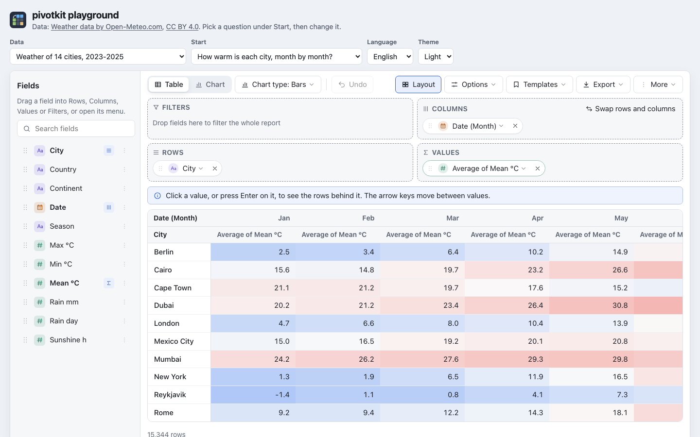

<p align="center">
  <picture>
    <source media="(prefers-color-scheme: dark)" srcset="assets/header-dark.svg">
    
  </picture>
</p>

Pivot report builder for the web: drag-and-drop fields, table and chart (Apache ECharts), views as
JSON files, native Excel export; as a JavaScript core, a React component and a web component.



<sub>Weather data by [Open-Meteo.com](https://open-meteo.com/) ([CC BY 4.0](https://creativecommons.org/licenses/by/4.0/)); contains modified Copernicus Climate Change Service information 2023 (ERA5) and 2019 (ERA5-Land), and ECMWF IFS data ([sources](examples/playground/data/SOURCES.md)).</sub>

| | |
| --- | --- |
| Build | [](https://github.com/eizedev/pivotkit/actions/workflows/ci.yml) [](https://github.com/eizedev/pivotkit/actions/workflows/docs.yml) |
| Documentation | [pivotkit.eize.dev](https://pivotkit.eize.dev/): [Use a report](https://pivotkit.eize.dev/use/) for the people who build reports, [Embed pivotkit](https://pivotkit.eize.dev/embed/) and the API reference for developers, a [live demo](https://pivotkit.eize.dev/demo/) and [Learn with real data](https://pivotkit.eize.dev/learn/) (weather, countries, earthquakes, Nobel laureates, software end of life) |
| npm | [](https://www.npmjs.com/package/pivotkit-core) [](https://www.npmjs.com/package/pivotkit-react) [](https://www.npmjs.com/package/pivotkit-element) [](https://www.npmjs.com/package/pivotkit-xlsx) |
| License | [](LICENSE) |

## Packages

| Package | What | Install |
| --- | --- | --- |
| [pivotkit-core](packages/pivotkit-core/) | The engine in plain JavaScript, no UI and no framework | `npm install pivotkit-core` |
| [pivotkit-react](packages/pivotkit-react/) | React 18/19 report builder: field list, drag and drop, table and chart, filters, saved and shared views, export; React and ECharts are provided by the host | `npm install pivotkit-react react react-dom echarts` |
| [pivotkit-element](packages/pivotkit-element/) | The report builder as the web component `<pivot-report>` with its own React, for Angular, PHP and plain HTML; ECharts loaded on the first chart | `npm install pivotkit-element` |
| [pivotkit-xlsx](packages/pivotkit-xlsx/) | A [plugin](https://pivotkit.eize.dev/reference/plugins/) that reads Excel workbooks (.xlsx) in the browser, checked before parsing; CSV and JSON are built into pivotkit-core | `npm install pivotkit-xlsx` |

## Example

The report builder in React (try it in the [playground](examples/playground/)):

```jsx
import { PivotReport } from "pivotkit-react";
import "pivotkit-react/styles.css";

<PivotReport data={rows} defaultView={{ rows: ["Region"], values: [{ field: "Sales", agg: "sum" }] }} onViewChange={save} />
```

The same as a web component, on a page without React (try it in the [example](examples/element/)):

```html
<script type="module" src="/assets/pivotkit-element/dist/index.js"></script>
<pivot-report locale="de-DE" default-view='{"rows":["Region"],"values":[{"field":"Sales","agg":"sum"}]}'></pivot-report>
<script type="module">
    const report = document.querySelector("pivot-report");
    report.data = rows;
    report.addEventListener("pivot-view-change", (e) => save(e.detail.view));
</script>
```

The engine without UI:

```js
import { encode, computePivot, toGrid } from "pivotkit-core";
import { toXlsx } from "pivotkit-core/export";

const data = encode(rows);                       // an array of objects
const result = computePivot(data, {
    rows: ["Region"],
    cols: ["Product"],
    values: [{ field: "Sales", agg: "sum", format: "currency:EUR" }]
});
const grid = toGrid(result);                     // cells with merges, totals and formatted text
const xlsx = toXlsx(grid);                       // Uint8Array
```

The view passed to `computePivot` is plain JSON: the same object is the saved template, the undo
step and what the UI edits. It is treated as user input: it cannot run code, and the limits in
`LIMITS` keep its memory use bounded. The [documentation site](https://pivotkit.eize.dev/) has the
details for users and developers: the [engine's API](https://pivotkit.eize.dev/reference/core/), the
[view](https://pivotkit.eize.dev/concepts/views/) and its
[limits](https://pivotkit.eize.dev/concepts/limits/), the
[component's props](https://pivotkit.eize.dev/reference/react/), the
[element's properties and events](https://pivotkit.eize.dev/reference/element/),
[theming](https://pivotkit.eize.dev/reference/theming/),
[security](https://pivotkit.eize.dev/security/) and the
[feature list](https://pivotkit.eize.dev/features/), every feature at a glance with links to the
details. The package READMEs are short npm pages that link there.

## Development

```bash
npm ci
npm run lint
npm run types                    # type check, generated .d.ts, TypeScript consumer test
npm test
npm run pack:check               # what npm pack would publish (every package)
npm run bench -w pivotkit-core
npm run bench -w pivotkit-xlsx   # reading a generated 94,000-row workbook (-- --browser: also Chromium)
npm run playground               # the playground on http://localhost:5173
npm run docs:data                # fetch the playground's real data sets again (network)
npm run test:browser             # Playwright in Chromium, Firefox and WebKit: playground, host pages, shadow root, web component
PIVOTKIT_REACT=19 npm run test:browser   # the same on React 19 (after npm ci --prefix tests/react19)
```

Releasing is described in [CONTRIBUTING.md](CONTRIBUTING.md#releasing).

## License

[MIT](LICENSE). Charts are drawn with [Apache ECharts](https://echarts.apache.org/) (Apache-2.0).
The images in `assets/` and `docs/assets/icon.svg` (icon, header, social preview) are made in
[eizedev/brand](https://github.com/eizedev/brand) and licensed
[CC BY 4.0](https://creativecommons.org/licenses/by/4.0/). The playground's real data sets keep the
licences of their sources, listed in [examples/playground/data/SOURCES.md](examples/playground/data/SOURCES.md).
