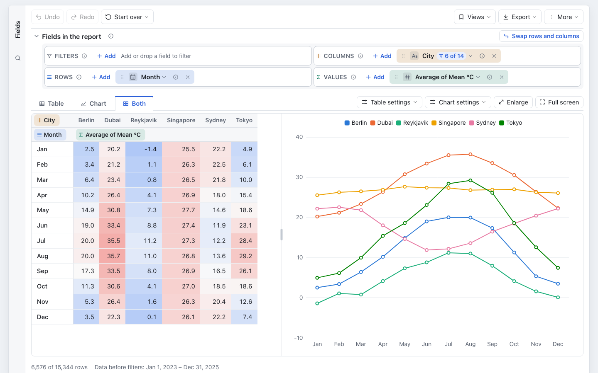
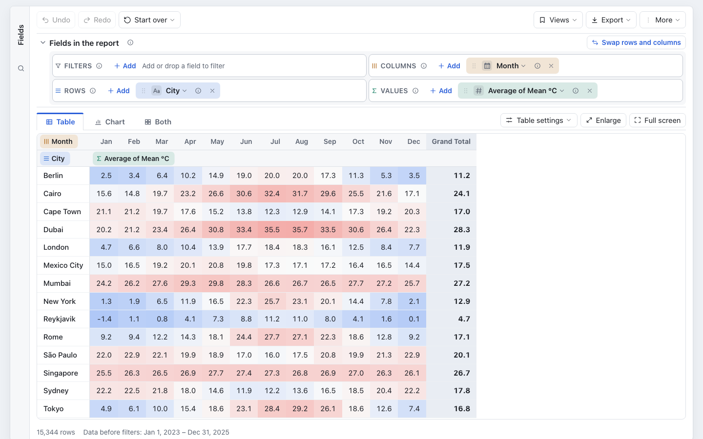
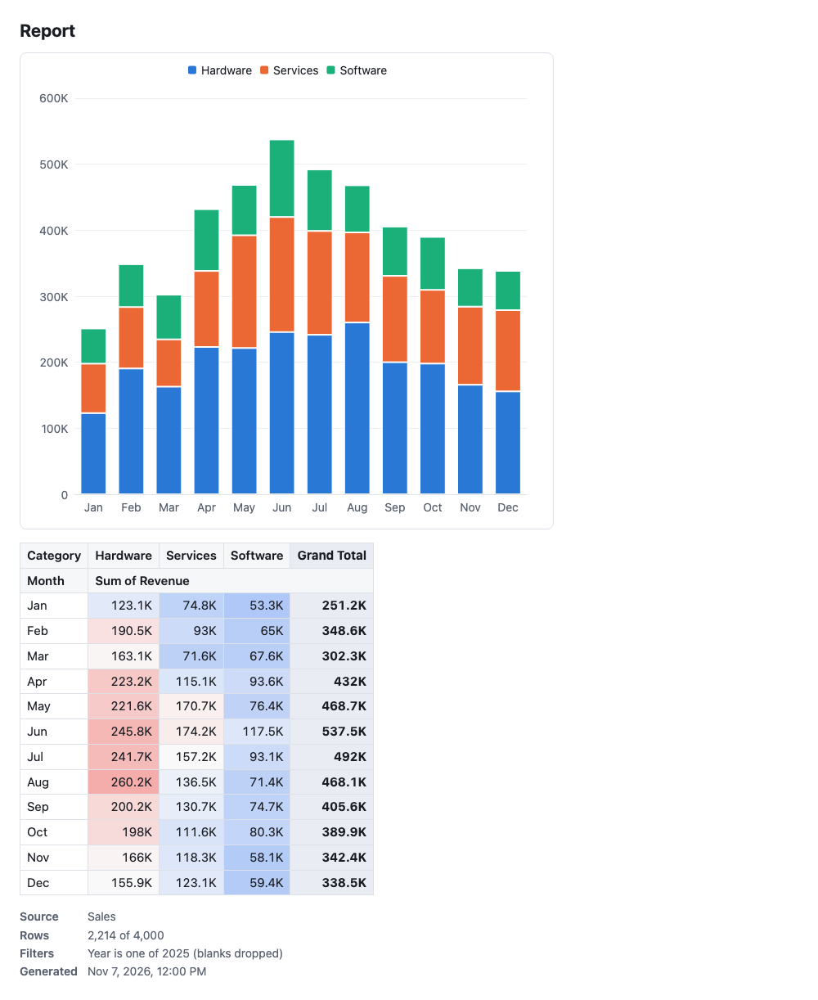
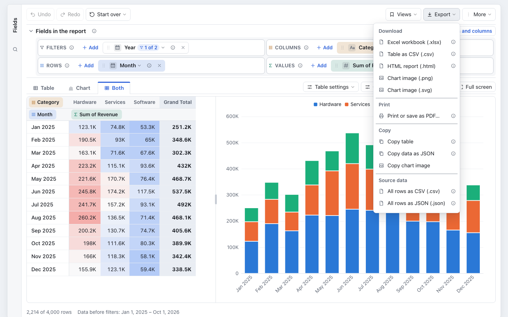
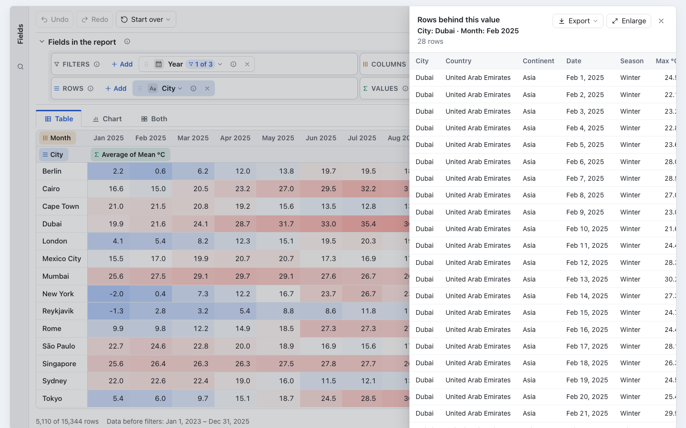
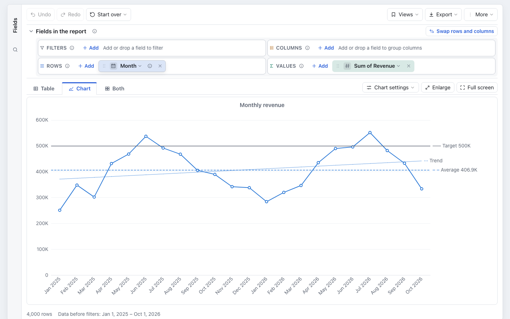

<p align="center">
  <picture>
    <source media="(prefers-color-scheme: dark)" srcset="assets/header-dark.svg">
    
  </picture>
</p>

pivotkit is Excel's PivotTable for web applications and the command line. People load their data,
build a report by dragging fields and take it to Excel. The same report renders again in CI.

<a href="https://pivotkit.eize.dev/demo/"><picture>
  <source media="(prefers-color-scheme: dark)" srcset="docs/assets/screenshots/readme-weather-dark.png">
  
</picture></a>

**[Try pivotkit](https://pivotkit.eize.dev/demo/)** · [Documentation](https://pivotkit.eize.dev/) ·
[Comparison](https://pivotkit.eize.dev/compare/) · [Releases](#releases-and-changelogs) ·
[Discussions](https://github.com/eizedev/pivotkit/discussions)

[](https://github.com/eizedev/pivotkit/actions/workflows/ci.yml)
[](LICENSE)

## Start here

- **You want to see it first:** [try pivotkit](https://pivotkit.eize.dev/demo/) in the browser, on
  the command line, on your machine, on a page of your own or in a container.
- **You build reports:** the six-step [quick start](https://pivotkit.eize.dev/use/quick-start/).
- **You run the services:** one `docker run` starts the REST service and the MCP server:
  [server in 5 minutes](https://pivotkit.eize.dev/getting-started/server-in-5-minutes/).
- **You use a running server:** the [REST service](https://pivotkit.eize.dev/getting-started/rest/)
  from curl or PowerShell, the [MCP server](https://pivotkit.eize.dev/getting-started/mcp/) from an AI client.
- **You develop:** put the report in your application or make reports from code:
  [Embed pivotkit](https://pivotkit.eize.dev/embed/).

> [!NOTE]
> pivotkit is 0.x. A minor release (0.y to 0.y+1) can break things. Each break is marked
> **Breaking** in the changelog, and [Upgrading](https://pivotkit.eize.dev/getting-started/upgrading/)
> says what to do. [Versioning](https://pivotkit.eize.dev/versioning/) has the full promise.

## What pivotkit does

- Table and Chart are tabs with their own settings. Charts zoom, stack to 100 % and draw reference lines.
- People drop their own CSV, JSON or Excel file onto the report. pivotkit uploads nothing:
  [load your own data](https://pivotkit.eize.dev/use/load-data/).
- The [export](https://pivotkit.eize.dev/use/export/) to Excel keeps the layout. The rows behind the
  report download as CSV or JSON.
- A view is safe JSON that cannot run code. The [command line](https://pivotkit.eize.dev/getting-started/cli/)
  renders the same report from it, also in CI.
- A [REST service](https://pivotkit.eize.dev/getting-started/rest/) and an
  [MCP server](https://pivotkit.eize.dev/getting-started/mcp/) make reports from live data. A model
  gets rows only where the policy shows them: [what reaches an AI model](https://pivotkit.eize.dev/model-data/).

<a href="https://pivotkit.eize.dev/demo/"><picture>
  <source media="(prefers-color-scheme: dark)" srcset="docs/assets/screenshots/readme-start-dark.png">
  
</picture></a>

<table>
<tr>
<td width="50%" valign="top"><b>HTML report</b><br>Ready to print or save as PDF<br><a href="docs/assets/screenshots/readme-report-light.png"><picture>
  <source media="(prefers-color-scheme: dark)" srcset="docs/assets/screenshots/readme-report-dark.png">
  
</picture></a></td>
<td width="50%" valign="top"><b>Export</b><br>Excel, CSV, chart image, copy<br><a href="docs/assets/screenshots/readme-export-light.png"><picture>
  <source media="(prefers-color-scheme: dark)" srcset="docs/assets/screenshots/readme-export-dark.png">
  
</picture></a></td>
</tr>
<tr>
<td width="50%" valign="top"><b>Drill-down</b><br>Click a value to see its rows<br><a href="docs/assets/screenshots/readme-drill-light.png"><picture>
  <source media="(prefers-color-scheme: dark)" srcset="docs/assets/screenshots/readme-drill-dark.png">
  
</picture></a></td>
<td width="50%" valign="top"><b>Charts</b><br>Average, trend and target lines<br><a href="docs/assets/screenshots/readme-chart-light.png"><picture>
  <source media="(prefers-color-scheme: dark)" srcset="docs/assets/screenshots/readme-chart-dark.png">
  
</picture></a></td>
</tr>
</table>

Open a picture to see it full size. Every feature: [feature list](https://pivotkit.eize.dev/features/).

The report in the browser computes on the rows the host passes and fetches no data. The services fetch
data from the sources you configure. pivotkit sends nothing home:
[network requests](https://pivotkit.eize.dev/security/#network). [Security](https://pivotkit.eize.dev/security/) ·
[Security policy](SECURITY.md) ·
[Measured performance](https://pivotkit.eize.dev/concepts/limits/#measured-in-the-browser)

The report runs in Chrome and Edge from 111, Firefox from 113 and Safari from 16.4:
[browser support](https://pivotkit.eize.dev/browser-support/). The engine, the command line and the services
run in Node 24 or later.
[What works with pivotkit](https://pivotkit.eize.dev/compatibility/) lists sign-in providers, MCP clients,
data sources and platforms, and how each was tested.

## Packages

- [pivotkit-react](packages/pivotkit-react/) [](https://www.npmjs.com/package/pivotkit-react): the React 18/19 report builder. The host provides React and ECharts.
  `npm install pivotkit-react react react-dom echarts`
- [pivotkit-element](packages/pivotkit-element/) [](https://www.npmjs.com/package/pivotkit-element): the report builder as the web component `<pivot-report>`,
  for Angular, PHP, plain HTML and PowerShell Universal. `npm install pivotkit-element`
- [pivotkit-core](packages/pivotkit-core/) [](https://www.npmjs.com/package/pivotkit-core): the engine in plain JavaScript, without UI. `npm install pivotkit-core`
- [pivotkit-xlsx](packages/pivotkit-xlsx/) [](https://www.npmjs.com/package/pivotkit-xlsx): a [plugin](https://pivotkit.eize.dev/reference/plugins/) that
  reads Excel workbooks in the browser. `npm install pivotkit-xlsx`
- [pivotkit-report](packages/pivotkit-report/) [](https://www.npmjs.com/package/pivotkit-report): [reports without a browser](https://pivotkit.eize.dev/reference/report/)
  as JSON, CSV, XLSX, SVG or HTML. `npm install pivotkit-report echarts`
- [pivotkit-cli](packages/pivotkit-cli/) [](https://www.npmjs.com/package/pivotkit-cli): the [command line](https://pivotkit.eize.dev/reference/cli/) `pivotkit`.
  `npm install --global pivotkit-cli`
- [pivotkit-server](packages/pivotkit-server/) [](https://www.npmjs.com/package/pivotkit-server): the [REST service](https://pivotkit.eize.dev/reference/rest/),
  also as a [container image](https://pivotkit.eize.dev/reference/container/).
  `npm install --global pivotkit-server pivotkit-mcp`
- [pivotkit-mcp](packages/pivotkit-mcp/) [](https://www.npmjs.com/package/pivotkit-mcp): the [MCP server](https://pivotkit.eize.dev/reference/mcp/),
  over stdio or HTTP. `npx -y pivotkit-mcp`

[pivotkit-node](packages/pivotkit-node/) is internal: the command line and the server share it.

## Example

The report builder in React. Try it in the [playground](https://pivotkit.eize.dev/playground/):

```jsx
import { PivotReport } from "pivotkit-react";
import "pivotkit-react/styles.css";

<PivotReport data={rows} defaultView={{ rows: ["Region"], values: [{ field: "Sales", agg: "sum" }] }} onViewChange={save} />
```

The web component and the engine without UI: [Embed pivotkit](https://pivotkit.eize.dev/embed/).

The command line, on example files it writes itself:

```bash
npx pivotkit-cli example                 # sales.csv and two views
npx pivotkit-cli render sales.pivotkit.json --data sales.csv -o sales.html
npx pivotkit-cli render sales.csv --rows Region --values sum:Revenue -o by-region.html   # no view file
```

The REST service and the MCP server in a container, with example data. The server makes a token at
its first start. Step by step:
[server in 5 minutes](https://pivotkit.eize.dev/getting-started/server-in-5-minutes/).

```bash
docker run -d --name pivotkit -p 127.0.0.1:3333:3333 \
  -v pivotkit:/var/lib/pivotkit ghcr.io/eizedev/pivotkit:0.5.0
curl -H "Authorization: Bearer $(docker exec pivotkit pivotkit-server token show admin)" \
  http://127.0.0.1:3333/api/v1/sources
```

The package READMEs are short npm pages that link to the [documentation](https://pivotkit.eize.dev/).

## Development

Start with these:

- [CONTRIBUTING.md](CONTRIBUTING.md) - how to set up, change, test and open a pull request.
- [PRODUCT.md](PRODUCT.md) - what pivotkit is and is not.
- [AGENTS.md](AGENTS.md) - layout, commands and code rules. AI assistants start here.
- [RELEASING.md](RELEASING.md) - how maintainers release.

```bash
npm ci
npm run lint
npm run types
npm test
npm run playground   # http://localhost:5173
```

## Releases and changelogs

Each package has releases of its own. The [GitHub releases](https://github.com/eizedev/pivotkit/releases)
list them with their notes. Each package keeps a `CHANGELOG.md`:
[core](packages/pivotkit-core/CHANGELOG.md), [react](packages/pivotkit-react/CHANGELOG.md),
[element](packages/pivotkit-element/CHANGELOG.md), [xlsx](packages/pivotkit-xlsx/CHANGELOG.md),
[report](packages/pivotkit-report/CHANGELOG.md), [node](packages/pivotkit-node/CHANGELOG.md),
[cli](packages/pivotkit-cli/CHANGELOG.md),
[server](packages/pivotkit-server/CHANGELOG.md), [mcp](packages/pivotkit-mcp/CHANGELOG.md).
Before you update, read [Upgrading](https://pivotkit.eize.dev/getting-started/upgrading/).
[Versioning](https://pivotkit.eize.dev/versioning/) says which releases may break things.

## Questions and help

- Questions, ideas and what you built with pivotkit:
  [Discussions](https://github.com/eizedev/pivotkit/discussions).
- Bugs and concrete feature requests: [issues](https://github.com/eizedev/pivotkit/issues).
- Security problems: report them [privately](https://github.com/eizedev/pivotkit/security/advisories/new).

## License

[MIT](LICENSE). pivotkit draws its charts with [Apache ECharts](https://echarts.apache.org/), licensed
Apache-2.0.

The icon, header and social preview in `assets/` and `docs/assets/icon.svg` come from
[eizedev/brand](https://github.com/eizedev/brand). Their licence is
[CC BY 4.0](https://creativecommons.org/licenses/by/4.0/).

The screenshots of the weather show data by [Open-Meteo.com](https://open-meteo.com/)
([CC BY 4.0](https://creativecommons.org/licenses/by/4.0/)). It contains modified Copernicus Climate
Change Service information 2023 (ERA5) and 2019 (ERA5-Land), and ECMWF IFS data.
The other screenshots show generated sample sales data.
The playground's real data sets keep the licences of their sources.
[examples/playground/data/SOURCES.md](examples/playground/data/SOURCES.md) lists them.
