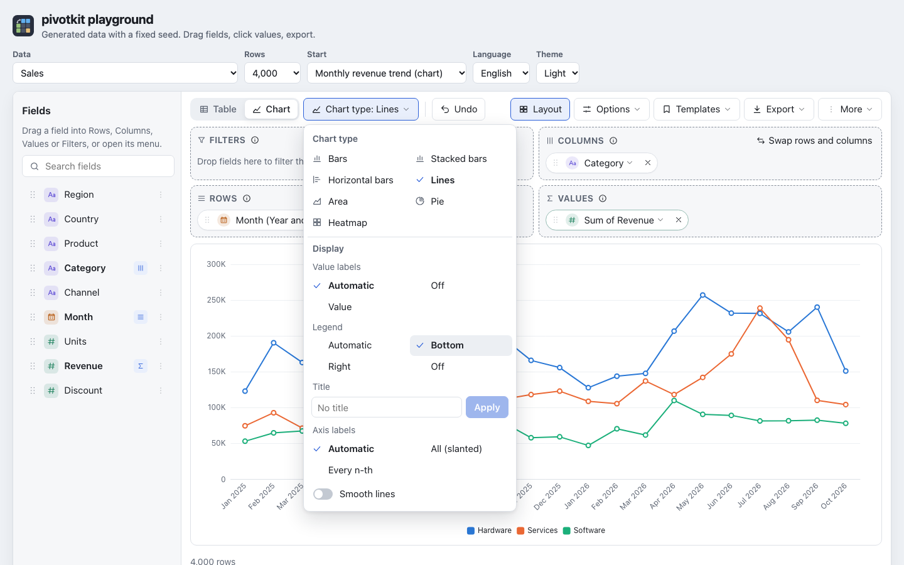
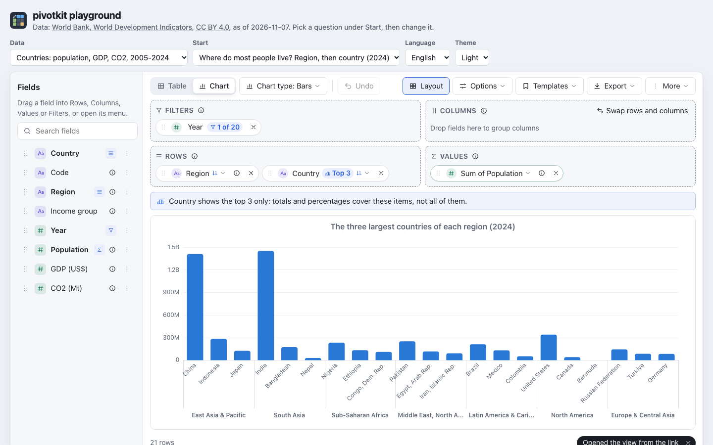

# Charts

**Chart** in the toolbar draws the same report as a chart: bars, stacked bars, horizontal bars,
lines, area, pie or heatmap. The categories are the items of Rows, one series per item of Columns and
value. At most 50 categories are drawn, with a note. A click on a bar, a point or a heatmap cell opens
the rows behind it, as in the table. The chart has a text alternative (type, values, counts, highest
and lowest value); its name includes the title when it has one ("Chart: Revenue by region").

## Display settings (for the people who use the report)

The chart type menu has a **Display** section under the chart types. Each choice applies at once and
the menu stays open, so the chart behind it shows the change. The settings are part of the view, so a
template, a link and the PNG export keep them, and they stay when the chart type changes.

| Setting | Choices | Default |
| --- | --- | --- |
| Value labels | Automatic, Off, Value; for a pie also Percent and Value and percent | Automatic: a pie names its slices, a heatmap writes the numbers while there are 200 cells or fewer, bars and lines write nothing |
| Legend | Automatic, Bottom, Right, Off | Automatic: above the chart when there is more than one series (a pie always) |
| Title | any text; the × removes it at once. A title wider than the chart ends in "…", on screen and in the PNG | none |
| Smooth lines | on, off (lines and area only) | off |
| Axis labels | Automatic, All (slanted), Every n-th (bars, lines and areas) | Automatic |
| Group labels under the axis | Automatic, On, Off (with two or more fields in Rows) | Automatic: shown while the chart has room for them |



**Axis labels.** Automatic writes every category straight when the longest name fits its place,
slanted by 45 degrees when they would overlap, and every n-th one (slanted) when not even that fits;
a line under the chart then says "One label in every 3 is shown". All (slanted) always writes every
label; Every n-th keeps them straight and leaves out as many as needed. A name longer than 120 px ends
in "…"; the tooltip has it whole. Horizontal bars write their names straight, every one while a line
fits each bar.

**Group labels.** With two or more fields in Rows (Region, then Country) the axis names each category
by its inner field (the country) and writes the outer field's item (the region) once under its
categories, with a line between two groups. Horizontal bars put the groups left of the names. Off
writes the whole path at each category ("Asia / Japan"). Automatic shows them only where they can be
read: a chart at least 420 x 260 px, and at least 56 px under the axis for the smallest group (28 px
beside it for horizontal bars); in a smaller chart, on a phone say, the axis writes the whole paths
instead. On shows them always.



**Lines over categories.** A line or an area connects its points into a trend. Over categories
without an order (countries, teams) that trend means nothing, so a tip says "Lines connect points into
a trend. For categories such as countries, bars fit better." with **Switch to Bars**. It does not show
for dates, number ranges or a custom order (the seasons), and not when the dates are on Columns (that
tip offers to swap).

**PNG export.** Export, "Chart image (.png)" saves the chart as it is drawn, at twice the screen's
resolution: with its title, legend, value labels and group labels.

In the view the settings are `chart.valueLabels` (`"auto"`, `"off"`, `"value"`, `"percent"`,
`"both"`), `chart.legend` (`"auto"`, `"bottom"`, `"right"`, `"off"`), `chart.title` (text, at most
`limits.name` characters, or `null`), `chart.smooth`, `chart.axisLabels` (`"auto"`, `"all"`, `"nth"`)
and `chart.groupLabels` (`"auto"`, `"on"`, `"off"`). A view without them gets the defaults; an unknown value
falls back to its default and is reported by `normalize()` ([Views](views.md)). "Percent" and "Value
and percent" are a pie's; another type writes the value.

## `chartOptions` (for developers)

`chartOptions` is a plain JSON object merged over the [Apache ECharts](https://echarts.apache.org/en/option.html)
option the report builds, for what the menus do not offer: a font size, axis names, margins, a
colour. It is a prop of pivotkit-react and a property of `<pivot-report>`.

```jsx
<PivotReport
    data={rows}
    chartOptions={{
        textStyle: { fontSize: 13 },
        title: { textStyle: { fontSize: 18 } },
        xAxis: { name: "Region", nameLocation: "middle", nameGap: 32 },
        series: { barMaxWidth: 24 },
        grid: { left: 48 }
    }}
/>
```

```js
document.querySelector("pivot-report").chartOptions = { legend: { textStyle: { fontSize: 14 } } };
```

How it is merged:

- objects key by key, so `{ title: { textStyle: { fontSize: 18 } } }` changes the font size and keeps
  the view's title text;
- a list entry by entry (`series: [{ ... }, { ... }]`), and an object given for a list into every
  entry of it: `{ series: { barMaxWidth: 24 } }` sets every series;
- any other value replaces the report's.

**Precedence.** The report builds the option from the view (its type and display settings), adds its
own styles (the theme's colours, rounded bars, the tooltip), then merges `chartOptions` over all of
it: the host wins. `{ legend: { show: false } }` hides the legend even when the user picked "Bottom",
so keep `chartOptions` to what the user should not change.

**Only JSON.** Strings, finite numbers, booleans, `null`, plain objects and arrays pass. Functions
(formatters), class instances (`Date`, `Map`), symbols, `Infinity`, the keys `__proto__`,
`constructor` and `prototype`, more than 12 levels and more than 2,000 entries are left out, with one
console warning that names them. It is compared by value, so a host may build a new object on every
render. The report's own formatters (numbers in the user's language) stay.

**No markup, addresses or templates.** Some ECharts options are not data: ECharts writes a string
`formatter` of the tooltip, and the tooltip's `content`, into the page as HTML (`innerHTML`), which
would run what it holds and replace the report's tooltip of plain text nodes (the one a strict
Content-Security-Policy allows); a title's `link` and `sublink` open a window. So these are left out
wherever they are in `chartOptions`, each named in the warning:

| Left out | Why |
| --- | --- |
| a string `formatter` (any depth: tooltip, labels, legend, axes) and a string `content` | written as HTML in the tooltip; the others are templates of the same kind and refer to `rich` |
| `rich` | text styles that templates refer to |
| `link`, `sublink`, `target`, `subtarget`, `linkTarget` | open an address |
| `image` and any text that starts with `image://` (a symbol) | load an address |
| `extraCssText`, `className`, `appendTo`, `appendToBody`, `renderMode` | change the tooltip's element and where it lives |

What is left of `chartOptions` is styles, sizes, numbers and names; nothing in it is markup or an
address, and nothing in it is run. The rule follows ECharts 6.1.0 (its `TooltipHTMLContent` and
`windowOpen`).
