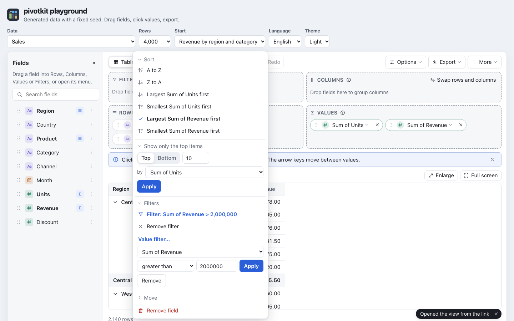

# Filters, top N and sorting

## Filters

A view's `filters` are a list; every filter names a field and a `type`. Item and text filters drop
source rows before anything is computed; value filters and top N drop whole groups after the values
are aggregated.

```json
"filters": [
    { "field": "Region", "type": "include", "items": ["North", null] },
    { "field": "Status", "type": "exclude", "items": ["Retired"] },
    { "field": "Rep", "type": "label", "op": "contains", "value": "an" },
    { "field": "Region", "type": "value", "op": ">", "value": 1000 },
    { "field": "Country", "type": "top", "count": 5, "bottom": false }
]
```

| `type` | What |
| --- | --- |
| `include` | Keep only the listed `items`; `null` is (blank). |
| `exclude` | Drop the listed `items`. |
| `label` | A text condition on the label. `op`: `equals`, `notEquals`, `contains`, `notContains`, `beginsWith`, `endsWith`. |
| `value` | A condition on an aggregated value. `op`: `=`, `!=`, `>`, `>=`, `<`, `<=`, `between`, `notBetween` (with `value2`). |
| `top` | Keep the `count` largest items, or with `bottom: true` the smallest. |

`value` and `top` rank by `by`, a value reference such as `{ "field": "Sales", "agg": "sum" }`; without
it they use the view's first value.

A filter on a field that is on rows or columns filters that axis. A filter on any other field - in
the UI, a field in the **Filters** zone - filters the whole report.

### Top N and value filters work within groups

A value filter on a field of an axis works **within each item of the field above it**, as in Excel:
with Region and Country on rows, "top 3 countries" keeps three countries per region. Totals then add up
the visible items only, so a region's total is the total of its top three countries.

Top N keeps exactly N items. A tie at the cut keeps the item that appears first in the data; Excel may
keep all tied items. The report says what a top N does to totals and percentages in a note above the
table ("Country shows the top 5 only: ...").

## Sorting

```json
"sort": [
    { "field": "Region", "by": "label", "order": "asc" },
    { "field": "Country", "by": "value", "order": "desc", "value": { "field": "Sales", "agg": "sum" } },
    { "field": "Season", "by": "custom", "items": ["Spring", "Summer", "Autumn", "Winter"] }
]
```

Each field on rows or columns is sorted on its own:

- `by: "label"` sorts by the item's label: text in natural order for the locale ("Item 2" before
  "Item 10"), numbers and dates by value. This is the default. Blank sorts last.
- `by: "value"` sorts by an aggregated value, `value` naming which one (default: the view's first).
  Items are sorted within their parent group.
- `by: "custom"` sorts in an order of your own, like Excel's custom lists: the `items` (named as
  filter items name them) first, in their order, then the field's other items by label. `order:
  "desc"` reverses both. Blank sorts last unless it is listed (`null`).

In the UI the menu of a row or column field offers "A to Z", "Z to A" (or "Oldest first", "Newest
first" for dates) and, for each value that gives a number, "Largest Sum of Revenue first" and
"Smallest Sum of Revenue first" (with the value's name); without a value it sorts by the number of
rows. A value gives no number to sort by when it lists distinct values, takes the first or last entry
of a text, or the average, median, minimum or maximum of dates; the menu leaves those out. The entry in
use has a check mark. "Custom order" and "Custom
order, reversed" are offered when the view has a custom sort for the field or the host gives the
field an order: `fieldDefaults: { Season: { order: ["Spring", "Summer", "Autumn", "Winter"] } }`. A
field with such an order is sorted in it as soon as it is placed on Rows or Columns, as a `custom`
sort in the view, so a saved template keeps it. A view or template that has the field on Rows or
Columns without a sort entry for it gets the same `custom` sort when the report shows it; "A to Z"
in the menu is then kept as a sort entry of its own, so the host's order does not come back.

## Filters in the UI

The filter of a field ("Filter…" in its menu, or a click on a chip in Filters) shows:

- Its values with their row counts, and "N selected" at the top. At most 300 values are listed; a
  longer list says "300 of 1,045 values; search to find more", and the search finds the others.
- **Select all** and **Select none** act on the values the search finds (all of them, also those past
  the first 300), **Only** next to a value keeps that one alone.
- A condition on the labels (`label` filter): is, is not, contains, does not contain, begins with,
  ends with; for a text field it is "Text condition", for a number "Condition on the label" (the
  number as the table writes it). A date (or a grouping of one) and a yes/no field have none: their
  items are chosen in the list; a condition a loaded view brings still shows, so it can be removed.
- **Remove filter** at its top while the field is filtered.

The values you tick are a draft until **Apply**. The report stores the values you did **not** tick as
an `exclude` filter, as Excel does: a value that appears in later data is shown. With every value
ticked, the field has no item filter at all.

A **value condition** (`value` filter) is in the menu of a row or column field, under **Value
filter…**: the value it compares (a select when the view has several values that give numbers, the
first one chosen), an operator (equals, does not equal, greater than, greater than or equal to, less
than, less than or equal to, between, not between) and a number, two for between. The number is
compared with the value's aggregated result as the engine computes it - the sum, the count, the
average - not with a "show values as" percentage and not with what its format shows: for "Revenue as
% of grand total", 0.25 is no condition on 25 %, 1000 is one on the sum of revenue. Between keeps
the items from the smaller to the larger number, in whatever order they were typed, and the chip
writes the smaller one first. Apply sets it, **Remove** (or Apply with no number) removes it, and changing it replaces it; it
is one undo step either way. A view may hold more than one value condition or top N for a field (from a
link, say): the menu edits the first one and leaves the others as they are. A condition whose value
is no longer among the report's values keeps it: the form offers it next to the values, chosen. The chip shows it in
short, "Sum of Revenue > 1,000" (a long one ends in "…"; its whole text is in the chip's name for screen
readers and in its tooltip), and so does the menu: "Filter: Sum of Revenue > 1,000". **Remove filter**
in the menu removes it together with the item list and the text condition; Top N stays.

Numbers are typed as the report's language writes them: "1.000,5" or "1000,5" in German, "1,000.5"
in English; a plain number with a point ("1000.5") is read in every language. Something else is no
number, and the field says so under it ("Enter a number, such as 1,234.5.") instead of guessing;
the same goes for the count of Top N and the size and start of number ranges.

**Show only the top items** in the same menu is the `top` filter: Top or Bottom, a count, and "by" the
value it ranks by (a select when the view has several values that give numbers; the first value is
the default). **Remove**, or Apply with no count, removes it; one undo step.



A field keeps its filters when it moves between Rows, Columns and Filters. A field that leaves the
report - its **x**, Remove field in its menu, or dragged back to the field list - takes its filters and its
sort with it; moved to Values, it leaves its filters behind. [Using the report](../guide.md#filters)
shows the filter itself.
