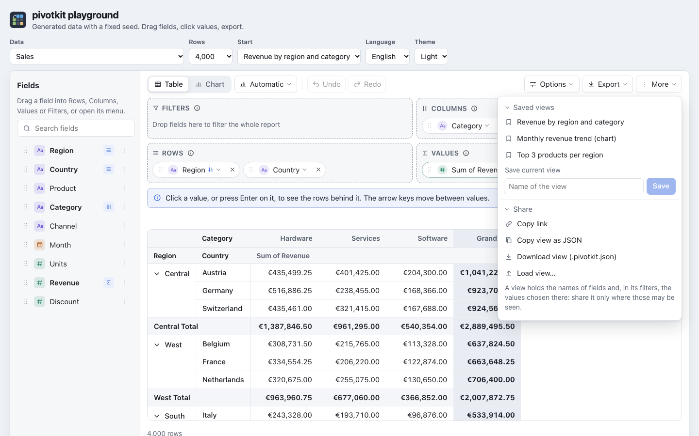

# Sharing and keeping a view

A report is its [view](views.md): a small JSON object with field names. The Templates menu shares
it in three ways and loads one, and a host can keep it per tab. Every view that comes in - from a
link, pasted text, a file or the tab's storage - is user input: it goes through `normalize()` against
the data, and what does not fit is left out and said in plain words.

## In the Templates menu (for the people who use the report)

Under **Share this view**:

- **Copy link** (when the application allows links): an address with the view in it. Whoever opens
  it sees the same report on the same data; Reset still goes to the application's start view.
- **Copy view as JSON**: the view as text, for a message or a ticket.
- **Download view (.json)**: the view as a file, named after the host's `fileName` with `-view.json`
  (`pivot-view.json` without one).
- **Load view…**: paste a view's JSON or a link and press **Load** (greyed out while the box is
  empty), or **Choose file…**, which loads the file at once. Nothing changes until it is loaded; it is
  one step that Undo takes back. A text of more than 1,000,000 characters, or a file of more than
  1,000,000 bytes, is refused before it is parsed ("This is too large for a view."); a text that is no view says why ("This is neither a
  view in JSON nor a pivotkit link.", "This view comes from a newer version of pivotkit and cannot be
  read here."); fields the data does not have are named after the load ("Some parts did not fit this
  data and were left out: fields this data does not have (“Planet”)").



Where a page does not allow the clipboard, the report says so and points to Download view.

## Links (for developers)

`shareLink` turns links on. `true` links to the page's own address without its query string (origin,
path and fragment: a query may hold a token or an id the host did not mean to share); a string is used
as the base URL as it is, so a host that wants its query in the link passes the whole URL. It is off
by default.

```jsx
<PivotReport data={rows} shareLink />
<PivotReport data={rows} shareLink="https://reports.example.com/sales" storageKey="sales" />
```

```html
<pivot-report share-link></pivot-report>
<pivot-report share-link="https://reports.example.com/sales" storage-key="sales"></pivot-report>
```

The view travels in the URL fragment, which browsers do not send to the server: `#pivot=<text>`, or
`#pivot-<storageKey>=<text>` when the report has a `storageKey`, so several reports on one page each
have their own. Only that entry is added or replaced: the rest of the fragment stays byte for byte,
also a hash route with its own query (`#/reports/a?tab=2&pivot=1.…`). With `shareLink` set the report
reads its entry after the first render (so a server render and its hydration match): a link at load is
where the report starts, with a new undo history (Reset still goes to the start view). When only the
fragment changes later (a link opened in the same tab), its view is one step, like Load view, and Undo
goes back to the view before.

The text is pivotkit's share format, `encodeViewLink` and `decodeViewLink` of
[`pivotkit-core/link`](../reference/core.md#links-pivotkit-corelink): `1.` and the view's JSON
compressed with DEFLATE ([fflate](https://github.com/101arrowz/fflate)), in base64url. It is capped
at 32,000 characters (a larger view is shared as a file; Copy link says so) and at 1,000,000
characters inflated: the compressed bytes go into the inflater 1 KiB at a time and it stops at the
first slice past the cap, so a crafted link (a deflate bomb) can neither make a large allocation nor
keep the page busy. The module is loaded on first use: a report that never shares does not load it
(pivotkit-element loads it as a chunk of its own, [bundle size](../reference/element.md#bundle-size)).

A host that keeps the view in its own address, as the playground does, writes the same entry with
`encodeViewLink(view)` on every `onViewChange`.

## Keeping the view per tab

`persistView="session"` (attribute `persist-view="session"`) keeps the view in the tab's
`sessionStorage` under `pivotkit:view:<storageKey>`: a reload shows it again, another tab starts
fresh. It is read after the first render, like the tips; blocked storage (a private window) changes
nothing. Reset goes to the start view, and that is what the tab keeps then. A link wins over the
stored view. Give each report on a page its own `storageKey`.

## The playground's address

The [playground](../demo.md) shows what a host can do with this. Its address has two parameters of its
own and the share format:

`?data=countries&start=where-do-most-people-live-region-then-country-2024#pivot-playground=1.…`

- `data` and `start` (the template's name in words) are the playground's: they pick the data set and
  the start template, and the Data and Start dropdowns write them.
- `#pivot-playground=` is the share format (the playground's `storageKey` is `playground`), written on
  every change; Copy link copies data, start (and `rows` for generated data) and the view, so a link
  opens exactly that report. The playground passes that URL as `shareLink`; its language, theme and
  height stay the viewer's own.

A React app, a page with `<pivot-report>` or a PowerShell Universal dashboard uses only the fragment
part, with its own data.
