# Using the report

This page is for the people who build reports with pivotkit. Everything here works the same in the
React component and in the web component; the [live demo](demo.md) is a good place to follow along,
and [Learn with real data](learn.md) has tasks to try on real public data.

<small>Weather data by [Open-Meteo.com](https://open-meteo.com/) ([CC BY 4.0](https://creativecommons.org/licenses/by/4.0/)); contains modified Copernicus Climate Change Service information ([attribution](learn.md#query-it-live)).</small>

## The parts

- **Fields** (left): every column of the data, with an icon for its type (text, number, date,
  yes/no) and a search. A mark next to a field shows which zone it is in. When the application
  describes a field, an **i** next to it says what the field means.
- **The zones**: **Rows** and **Columns** say how the table is split, **Values** what is computed in
  the cells, **Filters** what is left out of the whole report. The **i** next to a zone's title says
  what it does, with an example.
- **The toolbar**: Table or Chart, the chart type, Undo, Redo, Reset, Layout, Options, Views and
  Export. What does not fit the report's width moves into **More**, Reset first, then Layout, Views,
  Options and the chart type; Table or Chart, Undo with Redo and Export always stay. Which buttons are
  in More depends on the width only, the same in every language: a click on Layout never moves it.
- **The result**: the table or the chart, with tips above it, **Enlarge** and **Full screen** at its
  top right, and a status line below it.

## Adding fields

There are three ways, all with the same result:

- **Drag** a field into a zone. The lists and the page scroll while you drag.
- **Click** a field (or press Enter on it): numbers go to Values, everything else to Rows. A field in
  Columns or Filters moves to Rows; a field that is in that zone already stays, and the status line
  says so ("Region is already in Rows", "Revenue is already in Values"), so a second click or Enter
  never adds it twice.
- Open the field's **menu** (the three dots, or a click on the grip left of the field, which says
  "Drag into a zone") and choose "Add to Rows", "Columns", "Values" or "Filters". For a field in Values
  already the entry reads "Add to Values again": it adds a second value of the field (a second "Sum
  of Revenue", to show it as a share, say). A field that is not in the report yet also has
  **Filter…**: see [Filters](#filters).

A date is grouped as soon as it is placed, by the span of its values: up to 62 days by day, up to two
years by month ("Jan 2025"), up to six years by quarter, longer by year. The chip says so:
"Created by month". See [Dates and number ranges](concepts/dates.md).

## What a field means

When the application describes its fields, an **i** stands next to such a field in the list and on
its chips. Point at it, or move the focus to it with Tab, and the description appears; click or tap it
to keep it open, with **Learn more** when there is a page about the field. Escape closes it. On a phone a chip has no **i**; the same
text is at the top of the chip's menu and on the field's headers in the table and in the drill-down,
and the field search finds a field by words of its description. The application may also give a
field a clearer name than the data's; the report uses that name everywhere, also in the exported
files.

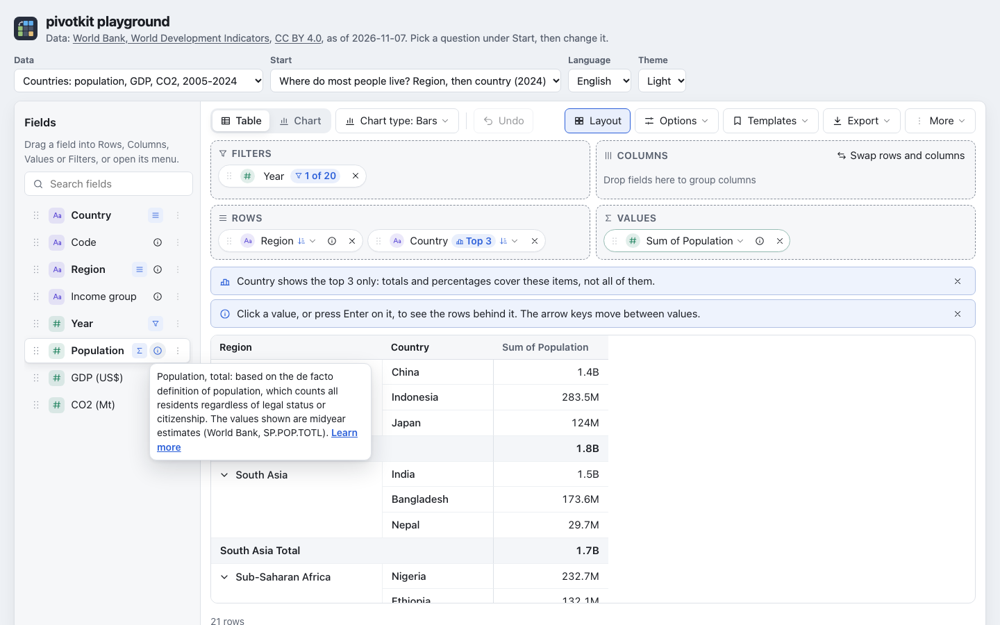

## Chips

Every field in a zone is a **chip**. A chip shows what is set on it: "3 of 4" for a filter, "Top 5",
a value condition ("Sum of Revenue > 1,000"), the sort.

- Drag a chip to reorder it or to move it to another zone.
- Drag it back to the field list, or press its **x**, to remove it. A note under the table offers Undo.
  A field that leaves the report takes its filters and its sort with it.
- Open its **menu** (the arrow) for everything else.

The menu of a **row or column field** has sort (by label; "Largest Sum of Revenue first" and
"Smallest Sum of Revenue first" for each value that gives a number, so with two values you choose
which one orders the items; and "Custom order" and "Custom order, reversed" when the field has one,
such as the seasons in the order of the year), date grouping (along the time line:
year, quarter, month, week, day; or across years: quarter, month, week of the year, weekday, hour),
number ranges (their size and where they start, "Starting at"; a new size keeps the start, an empty
start is 0, and a start so far from the field's numbers that every row would be blank is refused
with a note under it), top or bottom N by a value you choose, the filter with a value condition
("Value filter…"), and move. Remove field is always at the foot.

## Values

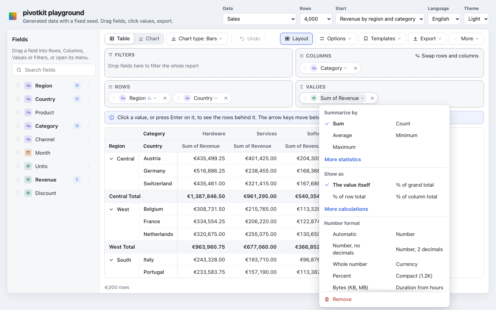

The menu of a **value** has these sections; Summarize by and Show as are open, the others folded
until you open them ([long menus](#menus-that-are-long)):

- **Summarize by**: sum, count, average, minimum, maximum; the statistics (median, distinct count,
  standard deviation, variance, first, last) under "More statistics".
- **Show as**: the value itself, % of grand total, % of row total, % of column total; differences,
  running totals and ranks under "More calculations", with an **Along** switch (Rows or Columns) for
  the direction they walk; an **i** next to Show as and next to Along explains them. The header then
  says it: "% of grand total of Revenue".
- **Number format**: automatic, number (also with no or two decimals), currency, percent; whole
  number, compact (1.2K), bytes and durations from hours or seconds under "More formats". A format the
  saved view brought along
  that is not in this list (a date, text, another currency) stays until you pick another.
- **Highlight**: a colour scale or data bars.
- Show as, Number format and Highlight are there only for a value that gives a number: not for a list
  of distinct values, the first or last entry of a text, or the average, median, minimum or maximum of dates.
- **Name**: type a name and Apply; the **×** gives the value its default name back at once
  ("Sum of Revenue", shown as the placeholder), as one step Undo takes back.
- Move, and a sentence on filtering: values are not filtered here; filter a field on Rows or Columns
  through its menu, or move a field to Filters.

What each one computes is in [Values](concepts/values.md).

## Filters

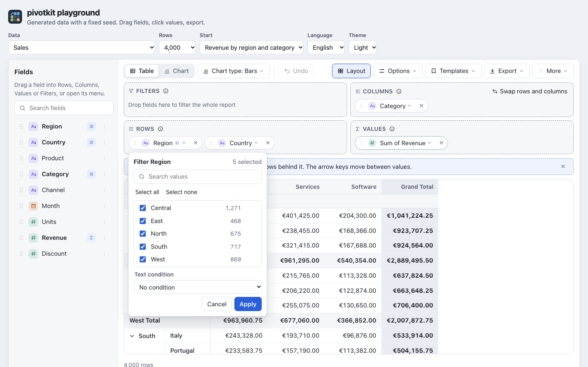

Open a field's menu and choose the filter (a chip in **Filters** opens it with a click). It lists the
field's values with their row counts and "N selected" at the top, with a search, "Select all",
"Select none" and "Only" next to each value (keeps that one alone), and a text condition (contains,
begins with, ...). At most 300 values are listed; below them "300 of 1,045 values; search to find
more" says that the search finds the rest. Select all and Select none act on what the search finds.
Your choice is a draft until **Apply**; **Cancel** or Escape leaves the filter as it was. A field in
the **Filters** zone filters the whole report.

The report remembers the values you left out, not the ones you kept: a value that is new in later data
shows up. With every value ticked, the field is not filtered at all.

- While a field is filtered, its menu says what the filter keeps, in the accent colour: "Filter: 15 of
  45" or "Filter: contains “an”", with **Remove filter** right below. The filter itself has **Remove
  filter** at its top.
- The **×** in the text of a condition removes the condition at once; the values you ticked stay
  until you apply them.
- A field that is not in the report yet: **Filter…** in its menu in the field list opens its filter at
  once. Apply puts it into Filters with what you chose; Cancel changes nothing. Moved to Rows or
  Columns later, it keeps its filter.

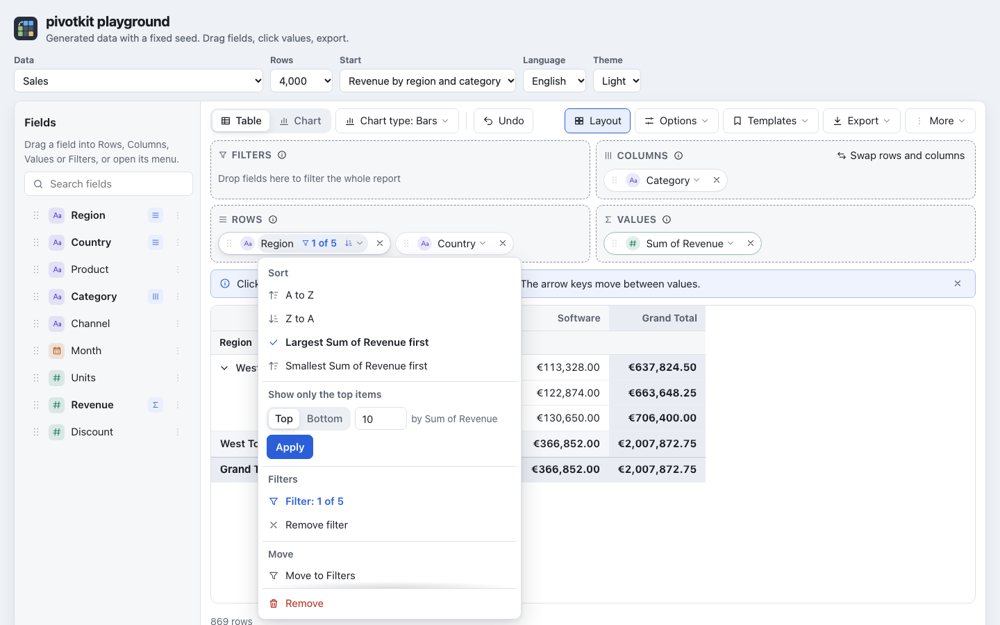

**Value filter…** in the menu of a row or column field keeps the items whose value meets a condition:
pick the value (when there are several), an operator such as "greater than" or "between", and the
number, written as in your language ("1.000,5" in German); a field that holds no number says so under
it. The number is compared with the sum (or count, or average) itself, not with a percentage the
value is shown as. The chip then shows it, "Sum of Revenue > 1,000", and so does the menu ("Filter: Sum of
Revenue > 1,000"); open the form again to change it, **Remove** (or Apply with no number) to remove it.

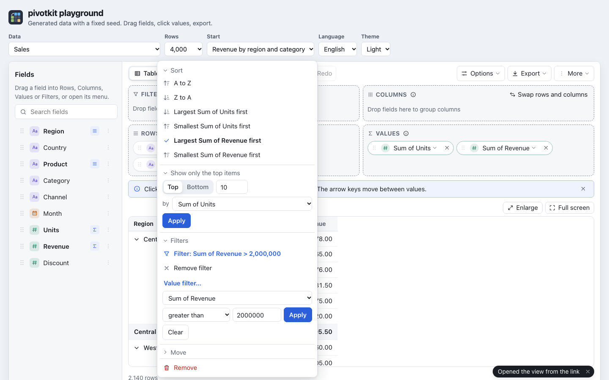

Top N ("Show only the top items") is in the same menu: Top or Bottom, how many, and by which value.
Notes above the table say what it does to totals and percentages ("Country shows the top 5 only:
..."). See [Filters, top N and sorting](concepts/filters.md).

## The table

- The header and the row labels stay in place while you scroll.
- Groups expand and collapse with the arrow next to them; Options has "Expand all" and "Collapse all"
  for the groups of Rows (groups of Columns open and close with their arrows only). Each is offered
  only when it changes something; otherwise a line under it says why ("Nothing is collapsed.", "Needs
  two or more fields in Rows.", "Every group is collapsed already."), and after a click the status
  line says what it did ("5 groups collapsed").
- **Swap rows and columns** (above Columns) swaps the fields, which groups are collapsed, and the
  direction of calculations: "% of row total" becomes "% of column total", a running total along Rows
  runs along Columns.
- Subtotals and grand totals are switched on and off in **Options**, each with an **i** that says what
  it does. A switch that would change nothing in this layout is greyed out with the reason under it:
  the grand total row needs a field in Rows, the grand total column a field in Columns, row subtotals
  two or more fields in Rows, column subtotals two or more fields in Columns.
- Field names and value names in the header can be dragged into a zone.
- With one value, its name stands once over all of its columns.
- The table is as wide as its columns and scrolls sideways when it is wider than the report. Long
  row labels wrap, so on a phone numbers stay in view next to them.

## The rows behind a number

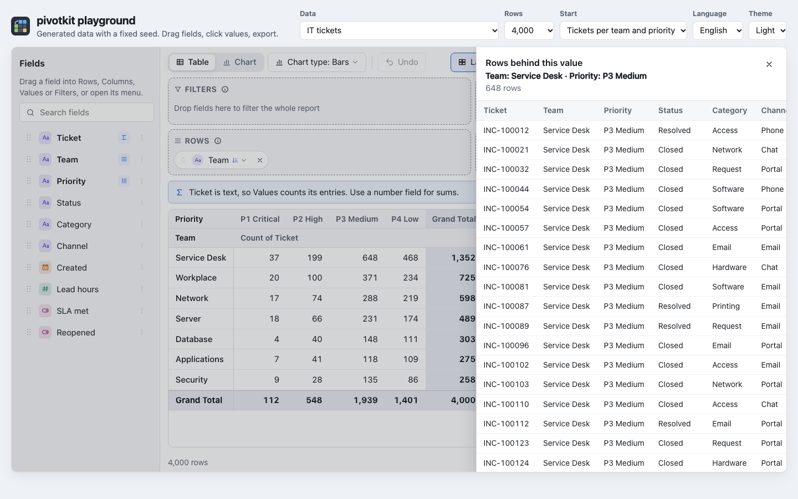

Click a value (or move to it with the arrow keys and press Enter) and a panel shows the rows behind it,
formatted as the table formats them: dates as dates, numbers in your language, yes/no fields as "Yes"
and "No". It covers the report while it is open: the focus stays in it, and Escape, its close button
or a click beside it closes it and returns to the value. The panel lists up to 1,000 rows by default;
with more behind the value its title line says "Showing the first 1,000 of 4,210 rows" (the
application can raise the limit, `drillDownLimit`). A blank cell with no rows behind it opens nothing.

Each column is as wide as its content; a long text wraps inside its column, so the panel scrolls
sideways less. **Enlarge** lets the panel fill the whole report; **Reduce** or Escape brings it back
to its size (a second Escape closes it), and the focus stays on the button. On a narrow report the
panel fills it already and has no Enlarge.

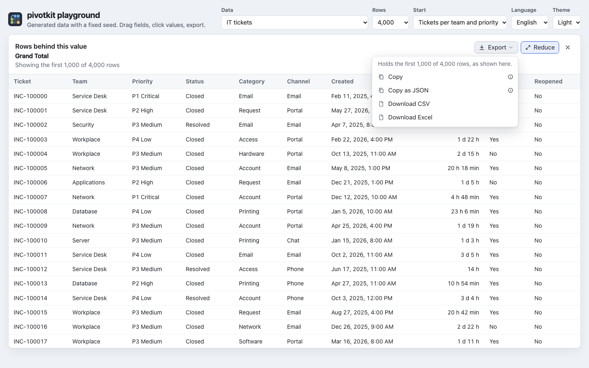

Its **Export** menu copies or downloads the rows it shows:

- **Copy**: the rows as the panel shows them (dates and numbers in your language), tab-separated
  with a header row. Pasted into Excel, Numbers or Google Sheets they land in columns, and a
  spreadsheet in the same language reads the numbers and dates back as numbers and dates. An **i**
  says so.
- **Copy as JSON**: the rows as objects with the data's field names and raw values (numbers as
  numbers, dates as ISO dates, blank `null`), for a program.
- **Download CSV** and **Download Excel**: the rows with the headers the panel shows, each value
  formatted as in the panel (a field's format, numbers with up to 6 decimals, dates as their day);
  the Excel file keeps numbers and dates as numbers and freezes the header row. Files and sheet are
  named after the cell: `Central – Jul 2026.csv`.

With more rows behind the value than the panel shows, every export holds the rows shown: the menu
says "Holds the first 1,000 of 4,212 rows, as shown here.", and the note after it "Copied 1,000 of
4,212 rows". Text a spreadsheet would run as a formula gets a leading `'`, as in every export.

## The chart

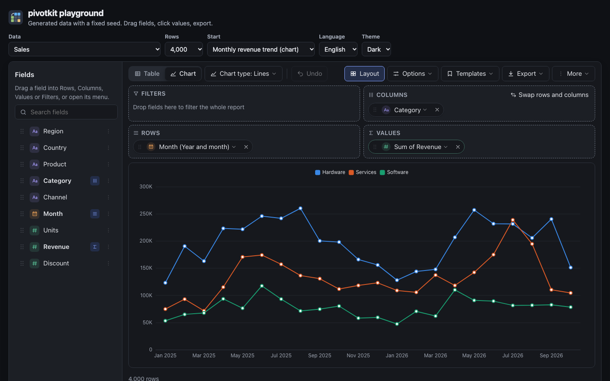

**Chart** in the toolbar shows the same report as a chart: bars, stacked bars, horizontal bars, lines,
area, pie, donut or heatmap (the button next to it). Until you pick one the type is **Automatic**:
dates draw lines along the axis (also dates on Columns: the chart swaps rows and columns for itself),
everything else bars. With a type you picked, a chart over dates gets a tip **Show as lines over
time**; a pie of more than about 7 slices a tip **Switch to Bars**. A click on a bar, a point or a heatmap cell opens
its rows, as in the table. Pointing at a category shows a tooltip with its whole name and one line per
series with its colour and the formatted value; on a pie, the slice; on a heatmap, the cell's row and
column and its value.

At most 50 categories are drawn, with a tip. With more than 8 series, or lines with the dates on
Columns, a tip offers **Swap rows and columns** (also above the Columns zone). Lines over categories
without an order (countries) get a tip with **Switch to Bars**.

The chart type menu also has **Display**: value labels, for a pie or a donut whether they stand
outside or inside the slices, legend, title, smooth lines, axis labels and, with two fields in Rows,
group labels under the axis. The settings stay with the report, also in saved views, links and the
PNG. All of it is in [Charts](concepts/charts.md).

## More room for the result

**«** next to "Fields" collapses the field list to a slim rail at the side of the report that shows
"Fields" and a search button: the zones and the result get its room. A click on the rail opens the
list again; the search button opens it with the cursor in the search field. A chip dragged onto the
rail leaves the report, as on the open list: while one is dragged, the rail reads "Drop here to
remove". The report remembers the choice (with the tips); an
application can start the list open or collapsed. On a phone the field list is a drawer, as before
([small screens](#small-screens)).

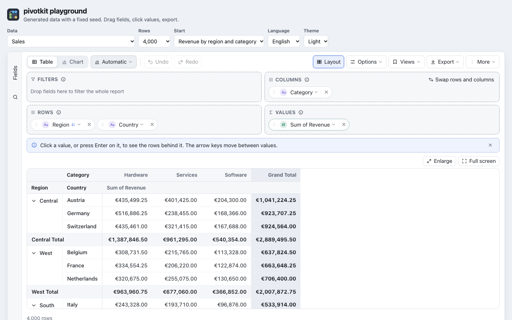

Two buttons at the top right of the result give it more room; neither is part of the view.

- **Enlarge** lets the table or the chart fill the report: the field list, the zones, the tips and
  the notes above the result step aside, and one line says which fields the report shows ("Rows:
  Team · Columns: Priority · Values: Count of Ticket"). The toolbar stays. **Escape** or the same
  button, which then reads **Reduce** (shown pressed), brings everything back.
- **Full screen** puts the whole report on the screen. **Escape** or the button leaves it. It is
  offered only where the browser can do it (not, for example, in Safari on an iPhone).

## Undo, saved views and export

- **Undo** (Ctrl+Z, on a Mac Cmd+Z) and **Redo** (Ctrl+Shift+Z or Ctrl+Y, Cmd+Shift+Z) step through
  every change. **Reset** goes back to the start view, as one step you can undo.
- **Views** lists the saved reports in two groups. **Shared views** are the same for everyone who uses
  the report; where someone can change them, an "i" next to one says who (by default "Only admins can change shared views."). **My views** are your own:
  "Save current view" saves yours under a name (up to 120 characters; Enter saves; the menu stays
  open with the new entry, so **Copy link** is one click away), and your own views can be deleted,
  after a confirmation. When the application allows it, the arrow next to one of your views
  publishes it as a shared view, after a confirmation. When the report keeps your views in the
  browser, the menu says so: they are only in this browser on this device, and gone when the site's
  data is cleared. **Share** copies a link (when the application allows
  links) or the view as JSON, downloads it as a file (`.pivotkit.json`), and **Load view…** opens one
  from pasted text or a file; a view made for other data asks first. A line there says that a shared
  view holds the values chosen in its filters: [Sharing and keeping a view](concepts/sharing.md).
- **Export** downloads the table as **Excel** (XLSX) or **CSV**, or the chart as **PNG**. The Excel
  file keeps every number with all its decimals, the number formats, the merged headers, the bold
  totals and the highlighting; its sheet has the file's name (made valid for Excel: at most 31
  characters). The CSV is UTF-8 with a byte order mark, so Excel reads accents and umlauts right; it
  writes percentages and "show values as" calculations as the table shows them ("-2.6%"); other
  numbers keep all their decimals; a row label is repeated on every row it spans. An **i** next to each
  format in the export menu says so too. The PNG is the chart as drawn, at twice the screen's resolution, on the report's
  background colour. The files are named after the application's `fileName` ("pivot" when it gives
  none): `pivot.xlsx`, `pivot.csv`, `pivot.png`; a downloaded view is `<name>.pivotkit.json`, after
  the view's or the data's name.
- **Export, Copy table** puts the table on the clipboard as it is shown: headers, labels and totals,
  every number as the table writes it ("1,234.5", "35.7%"), tab-separated, a row label repeated on
  every row it spans. Pasted into Excel, Numbers or Google Sheets it lands in columns; a spreadsheet in
  the same language reads the numbers back as numbers. A label a spreadsheet would run as a formula
  (it starts with `=`, `@`, or `+` or `-` and is no number) gets a leading `'`, as in the CSV. **Copy data as JSON** copies the table's data
  for a program: the header texts above each value column, and per row its labels and its values with
  all their decimals, a percentage of "Show values as" as the fraction (0.25 for 25%), a collapsed
  group marked as such (the shape is in [pivotkit-core's `toJson`](reference/core.md)). It is not the
  view: Views, **Copy view as JSON** copies how the report is built, not its numbers. Where the page
  does not allow copying (an address without https, a frame without the permission) a note says so:
  "This page does not allow copying. Download a file instead." A copy says what it gave: "Table
  copied: tab-separated, pastes into Excel or Google Sheets as columns", in the drill-down "Copied 25
  rows: …". The menu's sections, **Download** and **Copy**, fold like the other menus' sections.

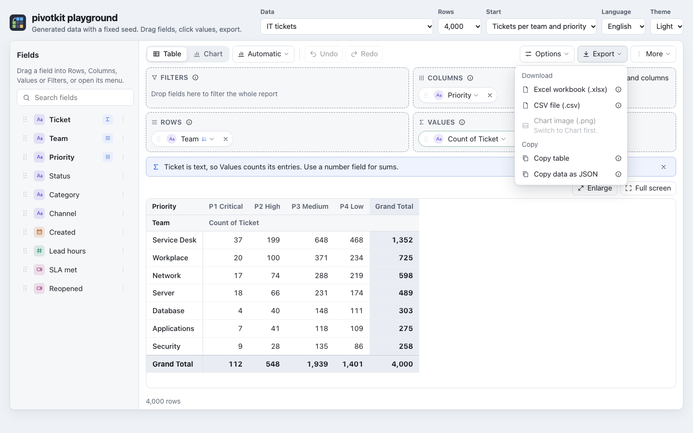

A button or menu entry that would do nothing is greyed out; where the reason is not obvious, a short
line under it says why, only while it is greyed out:

| Entry | Available when |
| --- | --- |
| Undo, Redo | there is a step to take back or to repeat |
| Reset | the report differs from the start view |
| Export, **Chart image (.png)** | the chart is shown and drawn ("Switch to Chart first.") |
| Options, Help, **Show dismissed tips again** | you dismissed a tip |
| Options, **Expand all**, **Collapse all** | it changes something; the line under it says why not |
| Options, **Grand total row**, **Grand total column**, **Row subtotals**, **Column subtotals** | it changes something in this layout; the line under it says what it needs |
| Views, **Save** | the name holds text |
| Chart type, Display, **Labels** (pie and donut) | value labels are not Off |
| Load view, **Load** | the box holds text (a chosen file loads at once) |
| The chart title's **Apply** | the title differs from the current one |

### Status messages

Notes such as "Undone: Region removed", "View “Sales” saved" or "Exported pivot.xlsx" appear at
the bottom right of the part of the report you see: under the table, or at the bottom of the window
when the report reaches below it, and a screen reader hears them. At most two
show at a time; each goes after 6 seconds, but stays while the pointer is on it or the focus is in it.
A loaded view says so with **Undo** ("View loaded", "Opened the view from the link"); when parts of it
did not fit ("View loaded; some parts did not fit this data") that is a warning: it goes like any
note, and the details stay above the result (below). Errors ("Export failed: ...") stay until you
close them with their **x**.

### Parts of a view that were not used

A saved view, a link or a loaded file can name things the data does not have (a field that is gone,
a value the field cannot compute). The report leaves them out and shows "Some parts of the view were
not used: 2" above the result; open it to see each part (what a loaded view left out in words, such as
"fields this data does not have (“Planet”)", or its path in the view, such as `filters[1].by`, and
why) - up to 20 of them. It stays until you dismiss it with its **x** or load another view.

### When the report cannot show anything

- Data without a single column: the field list says "The data has no columns."
- No field placed: the table shows three first steps and up to three saved views to start from.
- A layout over a limit: the result says what to change ("This layout makes more than 500,000 groups of
  rows and columns. Remove a field with many values from Rows or Columns, or filter it."), see
  [Limits](concepts/limits.md).
- Any other error: "The report cannot be shown:" and the error's message.

## Tips

Short tips above the result say what the report shows and what you can do next: that a top 5 changes
what the totals mean, what 100 % is for a percentage, that a text field in Values is counted, that a
date makes a column per day (with a button to group it by month), that a filter leaves nothing (with
**Remove filter**), that the view could be saved (**Save view** opens Views; after a save it waits
for more changes), that a chart over dates reads better as lines (**Show as lines over time**) or that
a pie has too many slices (**Switch to Bars**). One shows at a time, the most important first; the
next one waits until it is followed or dismissed. Never over the table. The notes that say the result is cut or empty (a top
5, the first 50 categories of a chart, a filter that leaves nothing) always stay; they have no x.

- The **x** of a tip (Tab reaches it) hides that tip; the report remembers it.
- **Options**, **Help** has **Show tips**, to switch them all off and on, **Show explanations** (every
  **i**: of the fields, the zones and the settings of the menus) and **Show dismissed tips again**. The report remembers the switches like the tips.
- **Options**, **Help**, **Keyboard shortcuts** lists the keys.

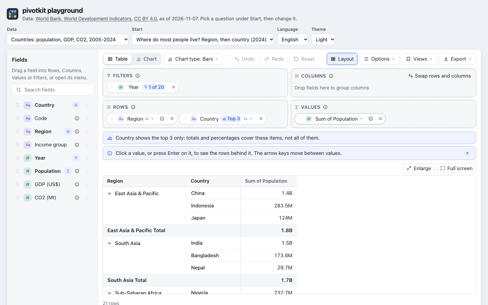

## Menus and text fields

- A setting that needs explaining has an **i** next to it: pointing at it or moving the focus to it
  shows the explanation, a tap opens it. It is the same **i** everywhere (totals, Show as, Along, the
  export formats, the chart's labels), so every menu row stays one line. **Options**, **Help**, **Show
  explanations** hides them all.

- Every text field in a menu - the field search, a value's name, "Starting at" of number ranges, a
  saved view's name, the text of a filter condition, the box of Load view - has an **×** while it holds
  text. It empties the field and keeps the focus there; Ctrl+Z in the field brings the text back.
- **Escape** in such a field empties it first; the next Escape closes the menu.
- While the report waits for its data, or opens a shared link, it shows grey shapes where the
  toolbar, the zones and the table will be, and a screen reader hears "Loading the report…".

## Menus that are long

- A menu keeps the mouse wheel to itself: at its end it stops, the table or the page behind it does
  not scroll; scrolling a long menu by touch stops at its end too. A menu is never higher than the window; what does not fit scrolls inside
  it.
- Its sections fold with their title. The ones used most are open: in a value's menu **Summarize by**
  and **Show as**; **Number format**, **Highlight**, **Name**, **Filters** and **Move** are folded. In
  a field's menu **Sort**, the date grouping, number ranges, **Show only the top items** and
  **Filters** are open, **Move** folded. The toolbar's menus start open. The report remembers what you open
  and fold, like the tips.
- Entries few people need sit behind a link in their section: **More statistics**, **More
  calculations**, **More formats** (whole number, compact, bytes, durations).

## Small screens

The report adapts to its own width. On a wide screen the field list is on the left and the zones in a
2 x 2 grid. On a narrow one the field list opens as a drawer with **Fields** in the toolbar, menus open
as sheets from the bottom of the window (at most 82 % of its height, scrolling inside), and toolbar
buttons that do not fit move into **More**, always in the same order (Reset, Layout, Views, Options,
the chart type) and by the report's width, so the same buttons show in every language; **Redo** stays
next to **Undo**. Row labels wrap between words; a table wider than the phone scrolls sideways. The drawer closes
with its **x** ("Close field list"), Escape or a tap beside it, and by itself once a field is added
from it, its "Filter…" opens or a drag starts, so you see where the field lands.

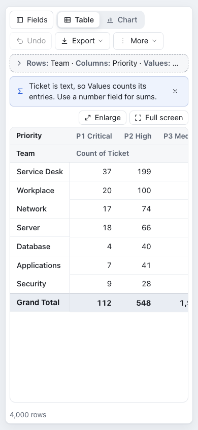{ width="320" }

When the report is low (below 600 px; a narrow one below 820 px), the zones fold into one line that
says what is in them ("Rows: Team · Columns: Priority · Values: Count of Ticket"), and at most one tip
shows; a click on the line, or **Layout** in the toolbar, opens them. **Layout** keeps its name and
shows pressed while the zones are open; in **More** it is an entry with a check. A drag from the field
list or the table opens them while it lasts. When the report's box is lower than its toolbar, its
zones, its tips and the least height of the result need, a report with a height of the host's (a
card) stays inside it and its table scrolls; a report without one grows and the page scrolls,
instead of squeezing the table into a sliver.

## Keyboard and screen readers

- Every action has a button or a menu entry; drag and drop is never the only way.
- Menus move with the arrow keys, **Home** and **End** jump to the first and the last entry, and Tab
  or Escape closes them.
- The field list is one stop of **Tab**: **Up** and **Down** move between the fields (**Home**,
  **End**), **Left** and **Right** to a field's grip, its **i** and its menu; **Enter** on a name adds
  the field, **Shift+F10** (or the context menu key) opens its menu, **Space** on the grip picks it
  up. A **Skip to the toolbar** link comes first. Options, Help, Keyboard shortcuts lists these keys.
- On a touch screen the small buttons (×, **i**, a field's menu and grip, a tip's x) are at least 44 px.
- A chip or a field handle is picked up with **Space**. **Left** and **Right** move it within a zone,
  **Up** and **Down** to the zone above or below; its position is announced ("Region is over Rows,
  position 2 of 3"). **Space** drops it, **Escape** cancels.
- In the table the arrow keys move between values and **Enter** or **Space** opens the rows behind one. An empty
  cell is a stop too; a screen reader hears "No rows" (nothing behind it) or "No value" (rows
  without a number).
- From 300 rows on a row label is cut to one line; the status line under the table shows the whole
  label of the row the focus is on, or of a label you tap.
- The chart has a text alternative: type, values, counts, highest and lowest value.
- The drill-down, the field drawer and the bottom sheets keep the focus inside while open and give it
  back when they close.

## In German

The report speaks English and German; numbers, dates and currency follow the language as well.

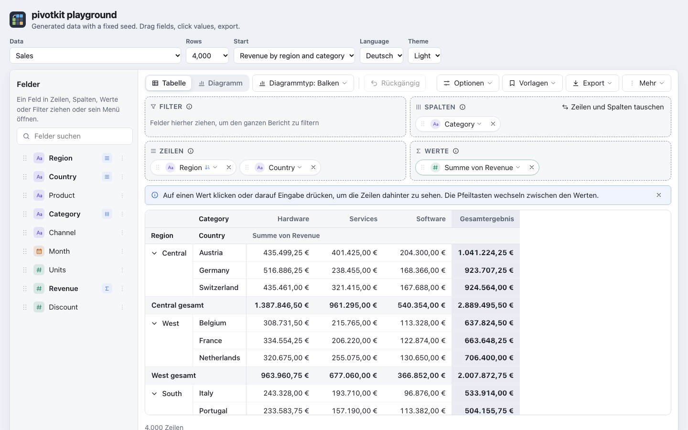
